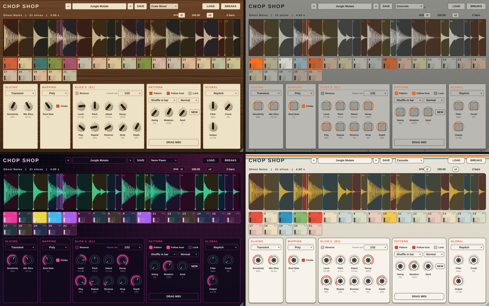

# Chop Shop (working name)

A transient slicer and beat repeater, in two builds:

- **Chop Shop** (instrument): load a break, and it finds the hits, cuts the break into slices and maps them to MIDI notes from C1, like a REX player.
- **Chop Shop FX** (effect): captures 1, 2, 4 or 8 bars of the track from the next downbeat, then slices it and mangles it.

A pattern player replays the break in time with the host. Each slice has its own chance to play, stutter, reverse or pitch-drop, so the break mutates by itself, and a seed plus a lock let you recall a pattern exactly. Slices drag out of the plugin as WAV files and the pattern drags out as a `.mid` clip. There are 8 pattern presets, 8 demo breaks synthesised in code (no sampled records) and four UI themes. See `docs/DESIGN.md` for how it works.



## Build

CI (`.github/workflows/build.yml`) builds universal macOS (11+) VST3 + AU + standalone and Windows x64 VST3 + standalone. It runs the engine tests and makes a `.pkg` and a `Setup.exe`, and on a `v*` tag publishes both to a GitHub Release.

```
cmake -B build -DCMAKE_BUILD_TYPE=Release            # fetches JUCE 8.0.4
# or: cmake -B build -DJUCE_DIR=/path/to/JUCE
cmake --build build --config Release
ctest --test-dir build                                # engine tests
```

macOS builds target macOS 11+ universal (Intel + Apple Silicon). No AVX2 or other `-march` flags are used: the DSP is scalar C++. Windows builds use the static runtime.

Layout: `Source/engine` is plain C++ with no JUCE (analysis, voices, pattern player, capture, presets, demo breaks), with tests in `tests/`. `Source/plugin` is the JUCE wrapper, the editor and the themes; `CHOPSHOP_FX` picks the build. `tools/Snapshot.cpp` (`-DCHOPSHOP_BUILD_SNAPSHOT=ON`) renders the screenshots and smoke-tests the processor and the built VST3s.

User presets are `.cspreset` files in `~/Library/Application Support/Chop Shop/Presets` (macOS) or `%APPDATA%\Chop Shop\Presets` (Windows). The session saves the break's audio (FLAC, 24-bit), the markers and the per-slice settings, so a project recalls exactly.
