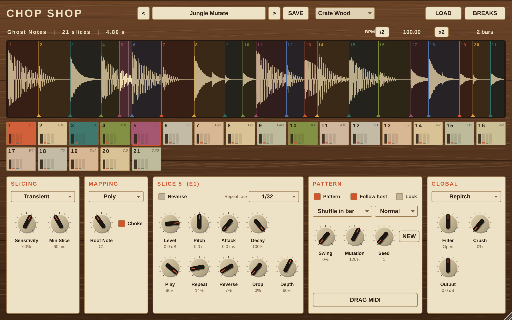

# Chop Shop (working name): design

Transient slicer and beat repeater. JUCE 8 + CMake. VST3 + AU + Standalone (instrument) and VST3 + AU (effect).
macOS 11+ universal (scalar C++, no `-march`) and Windows x64 (static CRT).

## Two builds

| | Chop Shop | Chop Shop FX |
|---|---|---|
| Slot | Instrument, MIDI in, stereo out | Effect with MIDI in, stereo in/out |
| Audio source | Loaded file (drop, LOAD) or a demo break (BREAKS) | Captured from the track: CAPTURE + 1/2/4/8 bars |
| Without a break | Silent | Passes the input through |

Both share every line of the engine; `CHOPSHOP_FX` only switches the buses, the header buttons and the Mix knob.
Some hosts don't send MIDI to effects, so the FX build's pattern player doesn't need MIDI.

## Signal flow

```
break audio --> analysis (message thread) --> Kit: slices + per-slice settings + tempo/bars
                                                   |
host transport --> pattern clock --> step plan (seeded) --> pattern voice (2 voices, crossfaded)
MIDI notes (root + slice) --------------------------------> 16 MIDI voices (poly / mono / choke)
                                                   |
                         sum --> filter (LP <- 0 -> HP) --> crush (bits + sample-hold) --> output --> [FX: dry/wet mix]
```

## Analysis (Source/engine/Analysis.cpp)

- **Transients:** spectral flux on a 1024-point STFT with a 256 hop (Hann, log-compressed magnitudes), normalised.
  An adaptive threshold (running median over +-8 frames plus an offset set by Sensitivity), then local-maximum peak picking.
  Each peak is refined in the time domain: the 32-sample frame with the biggest energy jump, then the first sample above
  20% of that frame's peak, then nudged back to the nearest zero crossing (at most 1 ms). Min Slice drops hits that are too close.
  The test click track (24 hits, irregular spacing and levels, noise floor) is found with a worst error of 0.06 ms; the target is 2 ms.
- **Grid 1/8, 1/16:** even divisions of the loop, nudged to zero crossings. **Manual:** the user's markers.
- **Tempo:** autocorrelation of the onset function. Each whole-bar tempo the file length allows (1, 2, 4, 8 or 16 bars,
  60 to 200 bpm) is scored by its periodicity at the half beat, the beat, two beats and the bar, times a log-normal prior
  around 115 bpm. Files that aren't a whole number of bars fall back to the most salient tempo. 7 of the 8 demo breaks
  come out exact; the 172 bpm drum-and-bass one reads as 86 (half time), which is why tempo and bars are editable
  (click to type, /2, x2).

## Playback (Source/engine/Voice.h)

- Slices play from their zero-crossing start with a 0.2 ms head fade (keeps the attack) and a 1.5 ms tail fade; a choke fades in 3 ms.
- **Time-stretch modes:** *Off* plays at the recorded speed (gaps or overlaps when the host tempo differs), *Repitch* plays
  at host/original speed, and *Stretch* keeps pitch with WSOLA: Hann grains of 2 x 11 ms, a new one every 11 ms, each started
  at the offset (+-5.5 ms) whose waveform best matches the natural continuation of the previous grain (normalised correlation).
  When speed and pitch agree it falls back to plain playback, so Stretch at the original tempo is bit-for-bit the break.
- **Per slice:** Level, Pitch, Reverse, Attack, Decay (fraction of the slice before it fades), plus the probabilities.
- **Repeat:** retriggers the slice head at 1/16, 1/32 or 1/64 notes (host time) for the rest of the step.
- **Pitch-drop:** a tape-stop ramp of speed (and grain pitch in Stretch mode) down to `1 - 0.94 x depth` across the step.
- Audio recorded at another sample rate plays at its own speed.

## Pattern player (Source/engine/Pattern.cpp)

- One step per slice at the slice's own position in the loop (so the groove survives), loop = bars x 4 beats.
  Swing pushes the slices that sit on off-beat 16ths later by up to a 32nd note (50% to 75%).
- **Order:** Original, Random (any slice per step), Reverse, Shuffle in bar (a seeded permutation inside each bar).
- **Speed:** Half / Normal / Double, against the host tempo.
- **Mutation** (0 to 200%) scales every probability: the skip chance (1 - Play), Repeat, Reverse and Drop.
- **Determinism:** every decision is a stateless hash of (seed, cycle, step, what's being decided), so a seed always gives the
  same pattern regardless of block size or where playback started. **Lock** drops the cycle from the hash, so every loop
  is identical. The seed is a parameter, so it's saved with the session and automatable.
- **Clock:** follows the host transport (ppq) when Follow host is on and the host gives a position; otherwise it runs
  free at the host's tempo (or the break's), which is what the standalone does.

## FX capture

CAPTURE (or the automatable Capture parameter) arms a capture. If the host is playing, recording starts on the next
bar line (from the host's time signature); otherwise it starts at once. N bars at the host tempo go into a buffer
allocated in `prepareToPlay` (33 s, i.e. 8 bars down to about 58 bpm). The message thread then slices the capture
(tempo and bars are known) and hands the new kit over to swap in on the next loop downbeat, so the pattern never jumps mid-bar.

## Threads

The message thread owns the editable Kit. Every edit (markers, per-slice knobs, presets, tempo) copies it to the engine
through an atomic pointer; the audio thread swaps it in and returns the old one through a lock-free queue that the
message thread frees. Voices still reading the old audio fade out before their kit is released. Nothing on the
audio thread allocates or frees.

## UI

The waveform across the top shows coloured slice regions, markers (double-click adds, drag moves, right-click deletes;
editing switches to Manual) and the play cursor. Below it, one pad per slice lights up as it plays, with four small bars
for play / repeat / reverse / drop chances. Click a slice or pad to select and hear it, and drag a pad out to drop the slice as a WAV.
DRAG MIDI drops four loops of the current pattern as a .mid clip (notes = root + slice, stutters written out).
Both drags use temp files and `performExternalDragDropOfFiles`, which works in Ableton Live, Logic, REAPER and FL Studio;
Max's sample drop hasn't been checked yet.

Themes (saved per session): **Crate Wood** (pine and cream, chicken-head knobs), **Concrete** (cast grey, safety orange,
square caps), **Neon Pawn** (black glass, pink/green glow rings), **Cassette** (shell white, label stripes, reel knobs).
The window resizes from 70% to 200% with a fixed aspect ratio.



## Presets

Pattern presets rather than sounds. They set the pattern parameters and write per-slice chances from each slice's
position in the bar, so they work on any break: Straight Chop, Jungle Mutate, Stutter Fills, Half-Time Drop,
Reverse Ghosts, Hip-Hop Skips, Tape Stop Ends, Random Rain. User presets save the parameters and all 64 slice settings.

## Demo breaks

Eight breaks are synthesised in `Source/engine/Breaks.cpp` from simple drum models (pitch-swept kick, tone + noise snare,
metallic hats, rim) and our own 2-bar grooves with swing, ghost notes and a little human timing: Dusty Pocket 92,
Rollout 172, Lazy Sunday 84, Skip Step 132, Parade 110, Half Brick 140, Ghost Notes 100, Breakroom 124.
They're original material, not samples of records. Real recorded breaks can replace them later.

## Tests

`tests/EngineTests.cpp` (402 checks):
- the parameter table
- the click track (every hit within 2 ms; sensitivity and min-length behaviour)
- tempo, bars and slicing for every demo break
- grid and manual modes
- seeded patterns repeating exactly (same seed and cycle, locked cycles, different seeds, shuffle keeps bars)
- a seeded render being bit-identical
- straight playback reproducing the break (correlation 0.999 in all three stretch modes)
- Repitch and Stretch filling the gaps that Off leaves at a slower host tempo
- every preset in every stretch mode
- MIDI mapping
- FX capture starting on the downbeat and swapping in on the next loop
- kit hand-over while playing
- CPU: 20 s of Stretch-mode playback in under 0.1 s

`tools/Snapshot.cpp` also checks the session round trip (audio, markers, per-slice settings, tempo), the MIDI and WAV
exports, and loads both built VST3s like a host would.

## Open items

- Brand name and plugin codes (`Chps`, `Chp1`, `Chp2`) are placeholders.
- Record real demo breaks to sit beside the synthesised ones.
- Check slice drag-out in Max.
